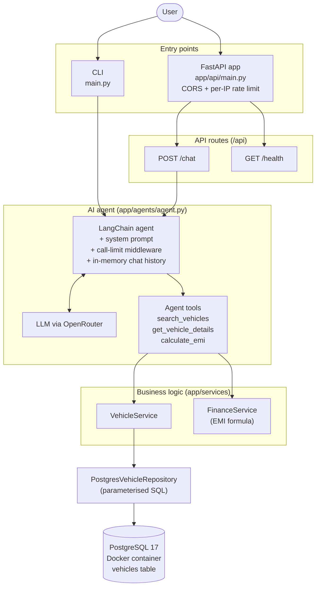
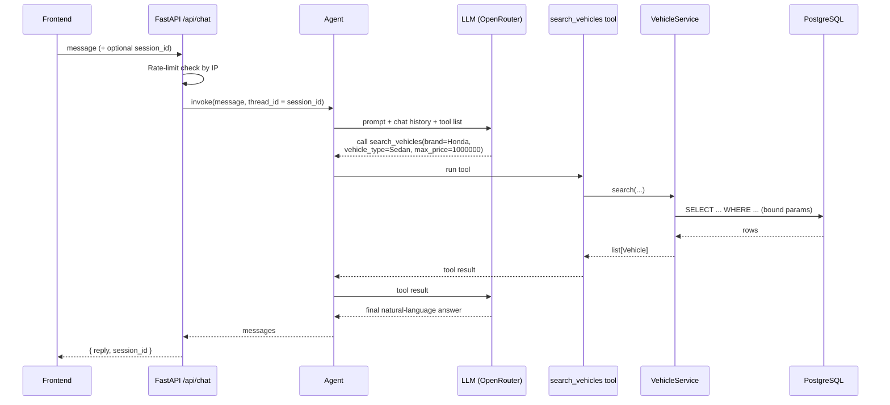

# Architecture

This document explains how the Vehicle Sales Assistant is built and how a
request moves through it. For setup and commands, see the [README](../README.md).

## 1. What the project does

The Vehicle Sales Assistant is an AI chatbot for Indian car buyers. A user
types a question in plain language, for example *"Find Honda sedans under 10
lakh"* or *"What is the EMI on 12 lakh at 9% for 5 years?"*, and the assistant
answers using real data from a PostgreSQL database.

It can be used in two ways:

- **CLI**: `python main.py` starts a chat loop in the terminal.
- **REST API**: `uvicorn app.api.main:app` serves a FastAPI backend that a
  frontend (React, Vue, etc.) can call.

Both entry points share the same agent, services and database code.

## 2. High-level flow



**In short:** the API exposes only `POST /chat` and `GET /health`. Every
vehicle search, vehicle lookup and EMI calculation goes through the AI agent,
which decides which tool to call; there are no separate vehicle or finance
endpoints. Every database read goes through
`VehicleService` and the repository; nothing else writes SQL.

## 3. Layers, one by one

The code is split into layers. Each layer only talks to the one below it,
which keeps the code easy to test and change.

| Layer | Folder / file | Responsibility |
|-------|---------------|----------------|
| Entry points | `main.py`, `app/api/` | Accept user input (terminal or HTTP), return the answer |
| Agent | `app/agents/agent.py` | Talk to the LLM, keep chat memory, decide which tool to run |
| Prompt | `app/prompts/vehicle_assistant.md` | Instructions for the LLM (tone, INR, lakh conversion, tool usage) |
| Tools | `app/tools/agent_tools.py` | Thin wrappers the LLM can call; they forward to services |
| Services | `app/services/` | Business logic: vehicle search, EMI calculation |
| Repository | `app/repositories/` | Data access. An abstract `VehicleRepository` interface with a PostgreSQL implementation |
| Models | `app/models/` | Pydantic data shapes: `Vehicle` (a DB row) and `SearchRequest` (search filters) |
| Database | `app/database.py`, `database/*.sql`, `docker-compose.yml` | SQLAlchemy engine, table schema, seed data, Docker container |

### Entry points

- **`main.py`** reads input in a loop, streams the agent's response and prints
  the final message. It uses a fixed conversation id, so memory persists for
  the whole terminal session.
- **`app/api/main.py`** builds the FastAPI app with `create_app()`: it adds
  CORS (allowed origins from `CORS_ORIGINS`), registers the rate limiter and
  mounts four routers under `/api`.
- **`app/api/dependencies.py`** provides the agent and services through
  FastAPI's `Depends`. They are created lazily and cached, so tests can
  replace them with fakes without needing a database or API key.

### The agent

The agent is created once with LangChain's `create_agent` and has four parts:

1. **Model**: an LLM reached through OpenRouter (`ChatOpenRouter`,
   `temperature=0` for consistent answers).
2. **System prompt**: loaded from `vehicle_assistant.md`.
3. **Tools**: the three functions the LLM is allowed to call.
4. **Middleware and memory**:
   - `ModelCallLimitMiddleware` caps LLM calls per run and per conversation
     (`run_limit=5`, `thread_limit=5`). When the cap is reached the agent
     raises an error, which callers turn into a friendly message (CLI) or an
     HTTP 429 (API).
   - `InMemorySaver` stores chat history per `thread_id`, so follow-up
     questions keep their context. History lives in RAM and is lost on
     restart.

### Tools, services and repository

- **Tools** contain no logic. `search_vehicles` takes a `SearchRequest`
  (brand, model, max_price, vehicle_type, all optional) and passes it to
  `VehicleService`. `calculate_emi` passes the loan values to `FinanceService`.
- **`VehicleService`** depends on the `VehicleRepository` interface, not on
  PostgreSQL directly. This is the *repository pattern*: the storage could be
  swapped (e.g. for an in-memory fake in tests) without changing the service.
- **`PostgresVehicleRepository`** builds a `SELECT` with only the filters that
  were given. Values are passed as bound parameters (`:brand`, `:max_price`),
  which prevents SQL injection. Text matches are case-insensitive, and the
  schema has matching `LOWER(...)` indexes so these lookups stay fast.
- **`FinanceService`** is pure Python with no I/O. It uses the standard EMI
  formula: `EMI = P × r × (1+r)^n / ((1+r)^n − 1)`, where `r` is the monthly
  rate, and returns the monthly EMI, total payment and total interest.

### Database

PostgreSQL 17 runs in a Docker container (`vehicle-pg`). On the first start
with an empty volume, it runs `database/schema.sql` (creates the `vehicles`
table and indexes) and then `database/seed.sql` (loads 200 vehicles). Data is
kept in the `vehicle_pgdata` volume. The app connects through a pooled
SQLAlchemy engine built from `DATABASE_URL`.

## 4. Walkthrough: one chat request

Here is what happens when a frontend sends
`POST /api/chat {"message": "Find Honda sedans under 10 lakh"}`:



Step by step:

1. **Rate limit.** slowapi checks the caller's IP against `RATE_LIMIT_CHAT`
   (default `10/minute;100/day`). Over the limit returns **429** with a
   `Retry-After` header.
2. **Session.** If no `session_id` was sent, a new UUID is created. It is used
   as the agent's `thread_id`, which selects the right chat history.
3. **LLM reasoning.** The LLM reads the prompt and decides it needs data. It
   converts "10 lakh" to `1000000` (as the prompt instructs) and asks to call
   `search_vehicles`.
4. **Tool call.** The tool calls `VehicleService`, which calls the repository,
   which runs the SQL query. Rows come back as `Vehicle` objects.
5. **Final answer.** The tool result goes back to the LLM, which writes a
   friendly reply listing the matching cars.
6. **Response.** The API returns `{reply, session_id}`. The frontend sends the
   same `session_id` with the next message to continue the conversation.

**Errors:** if the conversation hits the model-call limit, the API returns
**429** and the frontend should start a new conversation. Any other failure is
logged and returned as **500** with a generic message.

## 5. Public API surface

| Endpoint | Calls | Notes |
|----------|-------|-------|
| `POST /api/chat` | LangChain agent | Rate limited per IP (`RATE_LIMIT_CHAT`, default `10/minute;100/day`) |
| `GET /api/health` | none | Liveness check, not rate limited |

Vehicle search (`search_vehicles`), vehicle details (`get_vehicle_details`) and
EMI (`calculate_emi`) are agent tools only. Keeping them off the public API
means the chat endpoint is the single entry point, so one rate limit protects
both the LLM and the database.

## 6. Cross-cutting concerns

- **Validation**: Pydantic models check every input and output (`schemas.py`,
  `SearchRequest`, `Vehicle`), so bad data is rejected with a 422 before it
  reaches the services.
- **Security**: secrets live in `.env` (git-ignored); SQL uses bound
  parameters; CORS allows only configured origins; per-IP rate limiting
  protects the paid LLM endpoint.
- **Scaling note**: chat history and rate-limit counters are stored in process
  memory. With several workers or servers, move rate limits to Redis
  (`RATE_LIMIT_STORAGE_URI`) and the chat history to a shared checkpointer.
- **Observability**: optional LangSmith tracing (`LANGSMITH_TRACING=true`)
  records every LLM and tool call.

## 7. Testing and CI

| Test file | What it checks |
|-----------|----------------|
| `app/tests/test_finance_service.py` | EMI maths (unit test) |
| `app/tests/test_api.py` | Chat and health routes, rate limiting, with the agent replaced by a fake |
| `app/tests/test_vehicle_service.py` | Real queries against the Docker database (integration test) |
| `app/tests/evaluation.py` | Sample prompts and the tool the agent is expected to pick |

GitHub Actions (`.github/workflows/ci.yml`) installs dependencies and runs
`pytest` on every push and pull request.

## 8. Project layout

```text
.
├── main.py                     # CLI entry point
├── app/
│   ├── api/                    # FastAPI app, routes, schemas, rate limit, DI
│   ├── agents/agent.py         # LangChain agent setup
│   ├── prompts/                # System prompt + loader
│   ├── tools/agent_tools.py    # Tools exposed to the LLM
│   ├── services/               # VehicleService, FinanceService
│   ├── repositories/           # Repository interface + PostgreSQL implementation
│   ├── models/                 # Vehicle, SearchRequest
│   ├── database.py             # SQLAlchemy engine
│   └── tests/                  # Unit, API, integration tests + evaluation cases
├── database/                   # schema.sql, seed.sql (run on first DB start)
├── docker-compose.yml          # PostgreSQL container
└── docs/architecture.md        # This document
```
